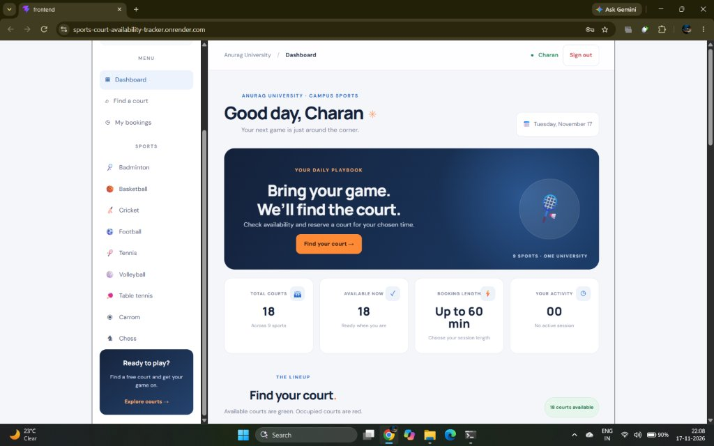
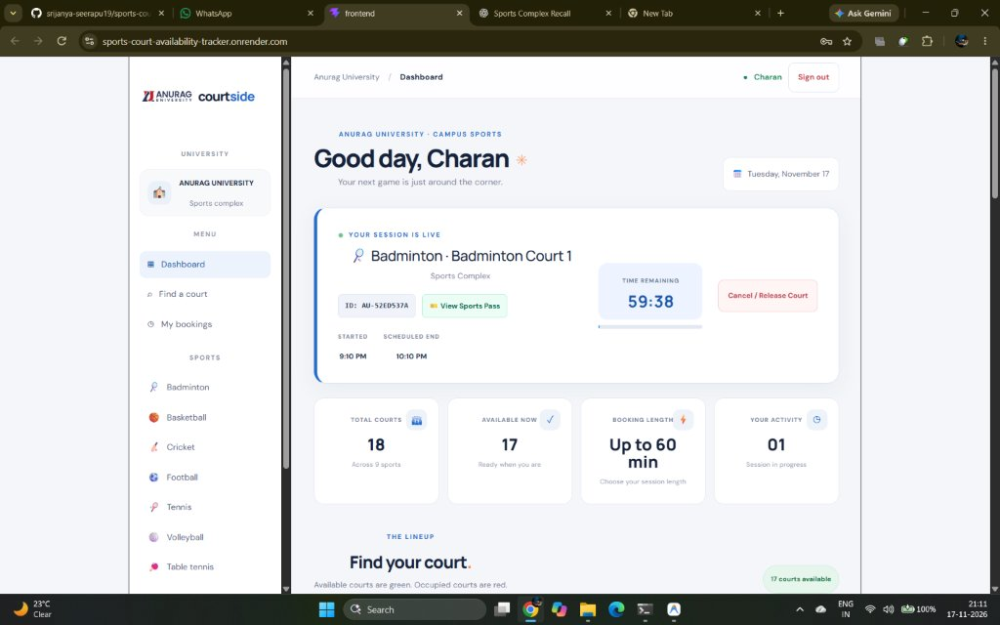
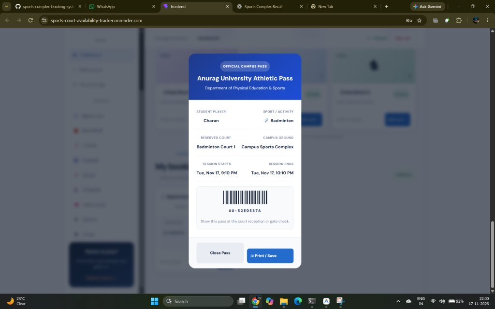
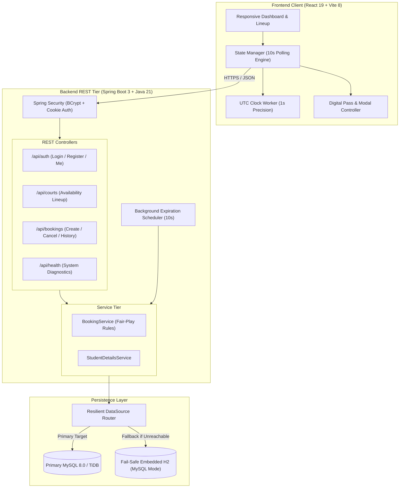
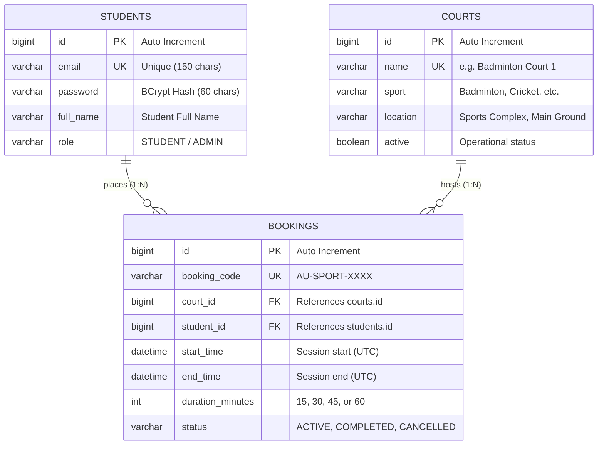

# 🏟️ Sports Complex Availability & Booking System

> **Discover. Check Real-Time Availability. Book Your Game.**

A full-stack, enterprise-grade web application designed to simplify sports facility discovery, eliminate queueing, and automate online slot reservations across university grounds and indoor complexes.

[](https://sports-court-availability-tracker.onrender.com)
[](https://sports-court-availability-backend.onrender.com/api/health)
[](https://react.dev/)
[](https://spring.io/projects/spring-boot)
[](https://openjdk.org/)
[](https://www.mysql.com/)
[](LICENSE)

---

## 🌐 Live Deployments

| Component | Platform | Live URL | Health / Status |
| :--- | :--- | :--- | :--- |
| **Frontend Web App** | Render Static Site | [sports-court-availability-tracker.onrender.com](https://sports-court-availability-tracker.onrender.com) | `Operational` |
| **Backend REST API** | Render Web Service | [sports-court-availability-backend.onrender.com](https://sports-court-availability-backend.onrender.com/api) | [Probe Health](https://sports-court-availability-backend.onrender.com/api/health) |
| **Database** | MySQL / TiDB / Fail-Safe H2 | Cloud Host (Port 3306) | `Connected` |

---

## 📖 Table of Contents
- [About the Project](#-about-the-project)
- [Problem Statement](#-problem-statement)
- [Key Features](#-key-features)
- [Application Screenshots](#-application-screenshots)
- [Technology Stack](#-technology-stack)
- [System Architecture](#-system-architecture)
- [Database Schema & ER Diagram](#-database-schema--er-diagram)
- [Complete Folder Structure](#-complete-folder-structure)
- [Local Installation & Setup](#-local-installation--setup)
- [REST API Reference](#-rest-api-reference)
- [Deployment](#-deployment)
- [Testing & Quality Assurance](#-testing--quality-assurance)
- [Future Enhancements](#-future-enhancements)
- [License](#-license)

---

## 📌 About the Project
The **Sports Complex Availability & Booking System** transforms campus and community sports operations from chaotic, paper-based reservation notebooks into a transparent, real-time digital booking hub. 

Serving athletes across **9 Olympic and university sports** (Badminton, Basketball, Cricket, Football, Tennis, Volleyball, Table Tennis, Carrom, and Chess), the platform enforces fair-play rules, automates court turnover, and generates verifiable digital passes for gate marshals.

---

## 🎯 Problem Statement
Manual sports complex scheduling creates significant administrative overhead:
1. **Double-Bookings & Physical Clashes**: Players travel across campus only to find occupied or locked facilities.
2. **Facility Hoarding**: Unrestricted court use prevents fair access for all students.
3. **Ghost Bookings**: When players leave early, courts sit idle while waiting lists remain locked.
4. **Paperwork Bottlenecks**: Facility staff struggle with manual logbooks, verification disputes, and lack of usage data.

**The Solution**: A cloud-connected, responsive web app featuring sub-second slot availability checks, single-concurrency student session locks, automated session expiration schedulers, and 1-click self-service court release.

---

## ✨ Key Features

### 👤 User Module
- **Self-Service Student Registration**: Fast sign-up with university credentials.
- **Secure Authentication**: BCrypt password encryption (strength 10) with HTTP-only session cookies.
- **Session Auto-Restoration**: Seamless background reconnection (`GET /api/auth/me`).

### 🏟️ Facility & Lineup Module
- **9 Sport Categories**: Badminton, Basketball, Cricket, Football, Tennis, Volleyball, Table Tennis, Carrom, Chess.
- **Real-Time Status Badges**: Visual color indicators:
  - 🟢 **Available Now** (Ready to book)
  - 🔴 **Occupied** (Live countdown showing remaining match time)
  - ⚪ **Maintenance** (Temporarily closed)
- **Instant Search & Availability Filtering**: Instant keyword search by ground/court name + toggle for *"Available courts only"*.

### ⚡ Booking & Concurrency Engine
- **Flexible Duration Selector**: Choose between `15 min`, `30 min`, `45 min`, or `60 min` slots.
- **Fair-Play Concurrency Lock**: Strictly limits each student to **one active session** at a time to prevent facility monopolization.
- **Branded Confirmation Dialog**: Custom modal displaying sport icon, venue location, player name, and duration prior to reserving.
- **Live Synchronized Countdown**: Real-time ticker (`MM:SS`) synchronized with UTC backend clock, complete with an animated session progress bar.

### ✕ Cancellation & Early Release
- **Double-Sided Cancellation**: Cancel directly from the top **Active Session Banner** or from individual cards in **My Booking History**.
- **Instant State Rollback**: Releases court lock immediately, freeing the venue for waiting players within milliseconds.

### 🎫 Digital Sports Pass
- **Official Athletic Pass Modal**: Generates a digital boarding pass with unique booking reference code (e.g. `AU-BADM-9482`), valid time window, and simulated barcode for campus security inspection.
- **1-Click Print / Save**: Offline backup for court reception check-in.

---

## 📸 Application Screenshots

### 1. Dashboard & Sports Court Lineup
*Homepage showing all 9 sports categories, real-time court availability, sport filter tabs, and navigation.*


### 2. Live Active Session with Real-Time Countdown
*Active booking view showing Badminton Court 1 with live 59:38 countdown timer, session ID, cancel button, and progress bar.*


### 3. Digital Sports Pass
*Official Anurag University Athletic Pass showing player name, reserved court, sport, session time window, and unique barcode for gate verification.*


---

## 🛠️ Technology Stack

```
Frontend:   React 19  │  Vite 8  │  Vanilla CSS3  │  HTML5 (WCAG 2.1 AA)
Backend:    Java 21 LTS  │  Spring Boot 3.3  │  Spring Security 6  │  Spring Data JPA
Database:   MySQL 8.0  │  TiDB Cloud Serverless  │  Fail-Safe H2 In-Memory
Deployment: Render Web Service  │  Render Static Site  │  GitHub Actions
```

---

## 🏗️ System Architecture



---

## 🗄️ Database Schema & ER Diagram



---

## 📁 Complete Folder Structure

```
sports-complex-booking-system/
│
├── README.md                      # Comprehensive Portfolio Documentation
├── LICENSE                        # MIT License
├── .gitignore                     # Git ignore rules for Maven & Node
│
├── docs/                          # Detailed Software Engineering Docs
│   ├── problem-statement.md       # Problem definition & stakeholder analysis
│   ├── requirements.md            # Functional & non-functional requirements
│   ├── system-architecture.md     # Architecture specifications & diagrams
│   ├── database-design.md         # Schema definitions, indexes & constraints
│   └── api-documentation.md       # Complete REST API schemas & status codes
│
├── frontend/                      # React 19 + Vite 8 SPA
│   ├── public/                    # Logos, SVG icons, manifest
│   ├── src/
│   │   ├── components/            # Modular UI (Navbar, ActiveSession, Modals)
│   │   ├── pages/                 # Route pages (Dashboard)
│   │   ├── services/              # API Client (authApi, courtApi, bookingApi)
│   │   ├── styles/                # Responsive CSS3 stylesheets
│   │   ├── App.jsx                # Core Dashboard container
│   │   ├── main.jsx               # React DOM bootstrap
│   │   └── config.js              # Dynamic API base URL resolver
│   ├── index.html                 # HTML template
│   ├── package.json               # Frontend dependencies & scripts
│   └── vite.config.js             # Vite configuration
│
├── backend/                       # Java 21 + Spring Boot 3 REST API
│   ├── src/
│   │   ├── main/
│   │   │   ├── java/com/sportscomplex/
│   │   │   │   ├── controller/    # REST API endpoints
│   │   │   │   ├── service/       # Domain business logic
│   │   │   │   ├── repository/    # Spring Data JPA interfaces
│   │   │   │   ├── model/         # Hibernate Entities
│   │   │   │   ├── config/        # Security, CORS, Resilient DataSource
│   │   │   │   └── SportsComplexApplication.java
│   │   │   └── resources/
│   │   │       └── application.properties
│   │   └── test/                  # Automated integration tests
│   ├── mvnw & mvnw.cmd            # Portable Maven wrapper
│   └── pom.xml                    # Maven dependency definitions
│
├── database/                      # Relational Database Artifacts
│   ├── schema.sql                 # Production DDL with composite indexes
│   ├── sample-data.sql            # Seed courts across 9 sports & demo users
│   └── relationships.md           # Foreign key constraints & check rules
│
├── screenshots/                   # Application Capture Gallery
│   ├── homepage.png               # Dashboard and court lineup view
│   └── active-booking.png         # Live session with countdown timer
│
└── tests/                         # Quality Assurance
    └── test-plan.md               # Test matrix, unit & E2E verification
```

---

## 🚀 Local Installation & Setup

### Prerequisites
- **Java JDK 21 LTS** (`java -version`)
- **Node.js LTS (v20+ or v24+)** (`node -v`, `npm -v`)
- **MySQL Server 8.0+** (Optional: embedded H2 activates automatically if MySQL is offline)
- **Git** (`git --version`)

### 1. Clone the Repository
```bash
git clone https://github.com/srijanya-seerapu19/sports-complex-booking-system.git
cd sports-complex-booking-system
```

### 2. Set Up Database (MySQL)
```bash
mysql -u root -p < database/schema.sql
mysql -u root -p < database/sample-data.sql
```
*(Note: If you don't run MySQL locally, the backend's resilient fallback will automatically initialize an in-memory database with starter courts).*

### 3. Run the Spring Boot Backend
```bash
cd backend
# On Windows:
.\mvnw.cmd spring-boot:run
# On Linux / macOS:
./mvnw spring-boot:run
```
Backend API will start at: `http://localhost:8080/api`

### 4. Run the React Frontend
```bash
cd ../frontend
npm install
npm run dev
```
Open `http://localhost:5173` in your browser.

---

## 📡 REST API Reference

| Method | Endpoint | Description | Access |
| :--- | :--- | :--- | :--- |
| `POST` | `/api/auth/register` | Register new student profile | Public |
| `POST` | `/api/auth/login` | Authenticate and issue session cookie | Public |
| `GET` | `/api/auth/me` | Fetch currently signed-in profile | Public |
| `POST` | `/api/auth/logout` | Terminate session | Public |
| `GET` | `/api/courts` | Retrieve all facilities and live bookings | Public |
| `POST` | `/api/bookings` | Reserve a court (15–60 min) | Authenticated |
| `GET` | `/api/bookings/mine` | View user's historical & active bookings | Authenticated |
| `DELETE` | `/api/bookings/{id}` | Cancel / release active booking | Authenticated |
| `GET` | `/api/health` | Service and database health check | Public |

*For complete request/response JSON schemas, view [docs/api-documentation.md](docs/api-documentation.md).*

---

## ☁️ Deployment

Both the frontend and backend are deployed on **[Render](https://render.com)**:

| Component | Live URL |
| :--- | :--- |
| **Frontend** | [sports-court-availability-tracker.onrender.com](https://sports-court-availability-tracker.onrender.com) |
| **Backend API** | [sports-court-availability-backend.onrender.com/api](https://sports-court-availability-backend.onrender.com/api) |

---

## 🔮 Future Enhancements
- [ ] **Advance Time-Slot Booking**: Reserve courts for tomorrow morning or specific hour slots.
- [ ] **"Looking for Players" Bulletin**: Find doubles partners or pickup match opponents across campus.
- [ ] **Equipment Rental Checkout**: Reserve rackets, balls, and shuttlecocks alongside the court.
- [ ] **Court Marshal Camera QR Scanner**: Instant check-in verification using student pass QR codes.
- [ ] **Automated Reminders**: SMS / WhatsApp notifications 10 minutes prior to session expiration.

---

## 📄 License
This project is licensed under the [MIT License](LICENSE).

**Author**: [Srijanya Seerapu](https://github.com/srijanya-seerapu19)  
**Email**: srijanyaseerapu@gmail.com  
**Institution**: Anurag University · Department of Electronics and Communication Engineering
