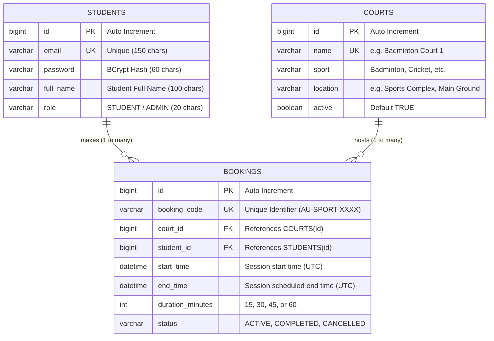

# Database Design: Sports Complex Booking System

## 1. Entity-Relationship (ER) Diagram



---

## 2. Table Specifications

### A. `students` Table
Stores student credentials and profile data.

| Column | Type | Constraints | Description |
| :--- | :--- | :--- | :--- |
| `id` | `BIGINT` | `PRIMARY KEY AUTO_INCREMENT` | Internal unique student identifier |
| `email` | `VARCHAR(150)` | `NOT NULL UNIQUE` | Official email address for authentication |
| `password` | `VARCHAR(100)` | `NOT NULL` | One-way BCrypt password hash |
| `full_name` | `VARCHAR(100)` | `NOT NULL` | Student display name |
| `role` | `VARCHAR(20)` | `NOT NULL DEFAULT 'STUDENT'` | Authorization role (`STUDENT`, `ADMIN`) |

### B. `courts` Table
Stores facility and venue assets available for booking across campus.

| Column | Type | Constraints | Description |
| :--- | :--- | :--- | :--- |
| `id` | `BIGINT` | `PRIMARY KEY AUTO_INCREMENT` | Unique court/ground identifier |
| `name` | `VARCHAR(80)` | `NOT NULL UNIQUE` | Distinct facility name |
| `sport` | `VARCHAR(40)` | `NOT NULL` | Associated sport category |
| `location` | `VARCHAR(120)` | `NOT NULL` | Campus physical location/ground |
| `active` | `BOOLEAN` | `NOT NULL DEFAULT TRUE` | Operational status (FALSE = maintenance) |

### C. `bookings` Table
Tracks real-time slot reservations, scheduled timelines, and audit history.

| Column | Type | Constraints | Description |
| :--- | :--- | :--- | :--- |
| `id` | `BIGINT` | `PRIMARY KEY AUTO_INCREMENT` | Unique booking database ID |
| `booking_code` | `VARCHAR(40)` | `NOT NULL UNIQUE` | Human-readable verification code |
| `court_id` | `BIGINT` | `NOT NULL, FK -> courts(id)` | Court being reserved |
| `student_id` | `BIGINT` | `NOT NULL, FK -> students(id)` | Student who booked the session |
| `start_time` | `DATETIME` | `NOT NULL` | Session start timestamp (UTC) |
| `end_time` | `DATETIME` | `NOT NULL` | Session scheduled end timestamp (UTC) |
| `duration_minutes` | `INT` | `NOT NULL CHECK (duration_minutes BETWEEN 15 AND 60)` | Slot length |
| `status` | `VARCHAR(20)` | `NOT NULL DEFAULT 'ACTIVE'` | `ACTIVE`, `COMPLETED`, `CANCELLED` |

---

## 3. Indexing Strategy & Query Optimization

To guarantee sub-100ms availability lookups even under heavy concurrent traffic, the database utilizes composite indexes:

1. **Active Court Lookup**:
   ```sql
   CREATE INDEX idx_bookings_court_status_time ON bookings (court_id, status, end_time);
   ```
   *Optimizes*: Checking if a specific court has an active reservation running past the current time.

2. **Student Concurrency Lock**:
   ```sql
   CREATE INDEX idx_bookings_student_status_time ON bookings (student_id, status, end_time);
   ```
   *Optimizes*: Verifying that a student has no active bookings before allowing a new reservation.

3. **Student History Ordering**:
   ```sql
   CREATE INDEX idx_bookings_student_start_desc ON bookings (student_id, start_time DESC);
   ```
   *Optimizes*: Fetching `GET /api/bookings/mine` with zero-cost sorting.
