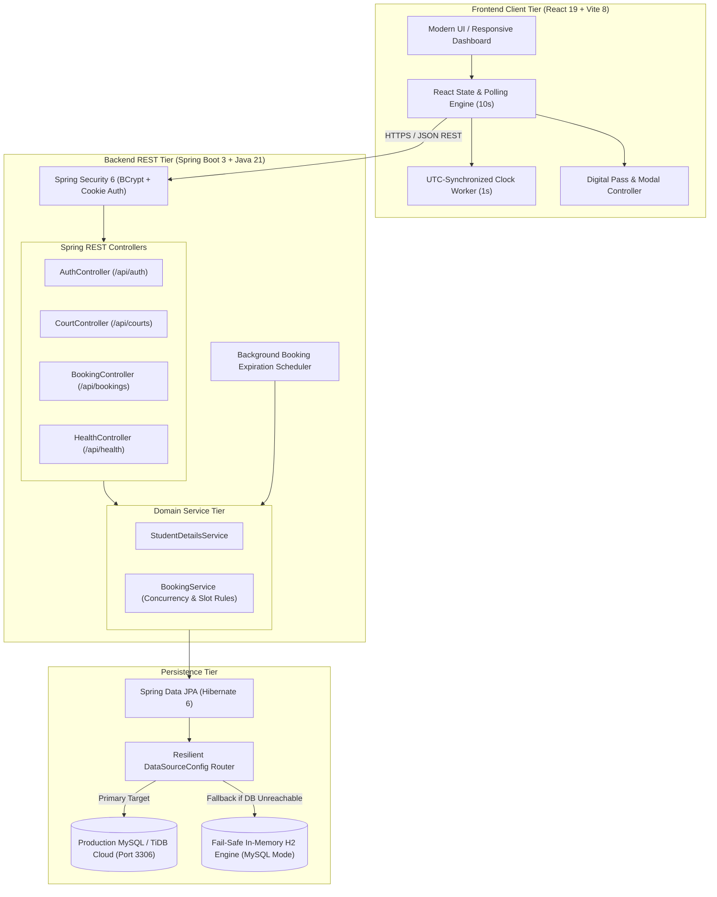
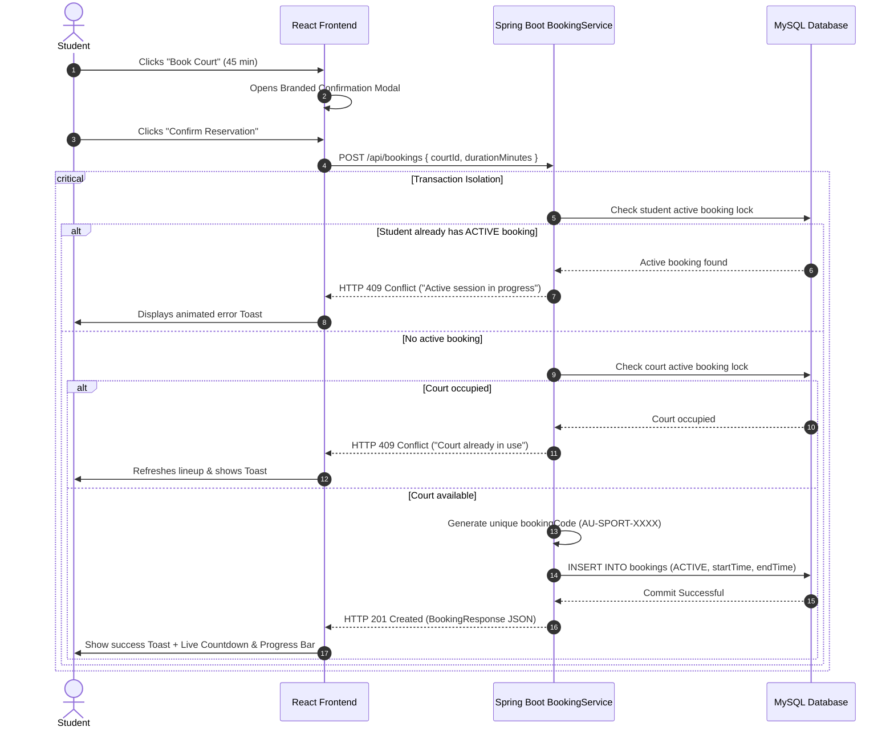
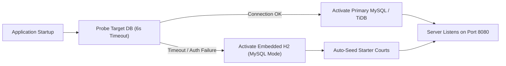

# System Architecture: Sports Complex Booking System

## 1. Architectural Overview

The application follows a modern **three-tier decoupled architecture** designed for high throughput, sub-second availability checks, and robust failover.



---

## 2. Request Lifecycle & Concurrency Flow

When a user initiates a booking reservation, the system validates slot availability and student concurrency before committing:



---

## 3. Resilience Architecture: Zero-Downtime Data Routing

Cloud deployments frequently suffer from transient database disconnects or trial cluster expirations. The backend includes a custom `DataSourceConfig` that prevents server crashes:



---

## 4. Component Directory Organization

```
com.sportscomplex/
├── controller/        # REST endpoints and request validation records
│   ├── AuthController.java
│   ├── BookingController.java
│   ├── CourtController.java
│   └── HealthController.java
├── service/           # Business logic, fair-play rules, status transitions
│   ├── BookingService.java
│   └── StudentDetailsService.java
├── repository/        # Spring Data JPA interfaces with custom JPQL queries
│   ├── BookingRepository.java
│   ├── CourtRepository.java
│   └── StudentRepository.java
├── model/             # JPA Entities mapped to relational schema
│   ├── Booking.java
│   ├── Court.java
│   └── Student.java
├── config/            # Cross-cutting security, CORS, and resilient DataSource
│   ├── DataSourceConfig.java
│   ├── SecurityConfig.java
│   └── WebConfig.java
└── SportsComplexApplication.java  # Bootstrap with default UTC Timezone
```
